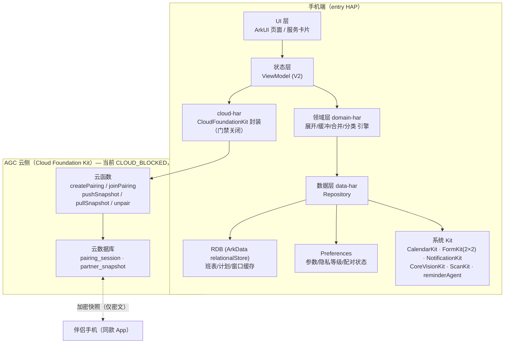
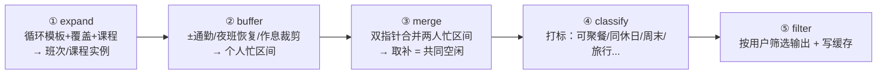
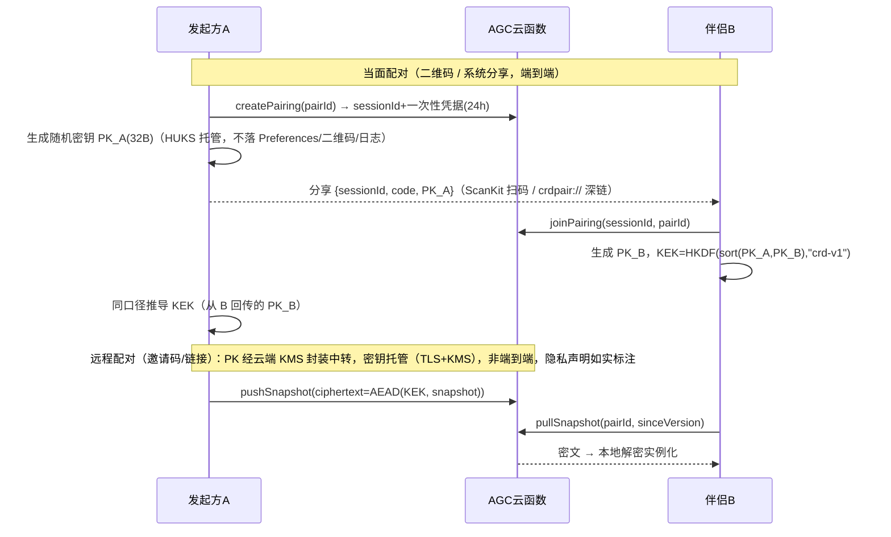

# 同休日 技术架构设计

| 项 | 内容 |
|----|------|
| 版本 | v1.1 |
| 日期 | 2026-09-15（v1.0 定稿于 2026-09-13） |
| 工程 | CommonRestday（HarmonyOS NEXT，**API 26 / SDK 26.0.0**，Stage 模型，ArkTS；`build-profile.json5` 的 compile/target/compatible 三项均为 `26.0.0`） |
| 配套 | [产品设计文档](./01-产品设计文档.md) · [功能链路设计](./03-功能链路设计.md) · [改造方案](./superpowers/plans/2026-09-21-overall-project-redesign.md) |

> **v1.1 修订**：① 数据模型增加 `owner` 维度支持本机代录双人模式（PRD F2.0）；② 引擎输入支持"伴侣本机课表"路径（与快照路径二选一）；③ STUDY 标签判定明确化；④ 云端相关设计标注"AGC 就绪后生效，未就绪降级本机代录"。

> **2026-09-23 定点更正（阶段 6 Task 6.3）**：本文写于改造之前，以下几类陈述已被代码与 05/06 调研推翻，逐条就地标注：
> ① API 版本（旧稿 21 → 实际 26.0.0）；② **不接 Account Kit 登录**（全仓无 `@kit.AccountKit` 依赖）；
> ③ **Live View Kit / OneHop / Push Kit 不在架构内**（无依赖、无声明）；④ 卡片**只有 2×2**；
> ⑤ 导航是**三个底部入口 + Navigation 栈**，不是四 Tab；⑥ 端云配置是 `cloud-config.json`，**不存在 `agconnect-services.json`**。
> 冲突时以代码 + [改造方案](./superpowers/plans/2026-09-21-overall-project-redesign.md) + [灰度与回退](./release/rollout-and-rollback.md) 为准。
> 云端整条链路当前关闭（Task 0.4 门禁 `CLOUD_BLOCKED`，见 [验证记录](./validation/clouddev-api26-spike.md)）：下文所有云侧设计都是**门禁通过后的目标态**，不是现状。

---

## 1. 工程现状与选型基线

- 工程现状：1 个 HAP（`entry`）+ 5 个 HAR（`commons` / `domain` / `data` / `cloud` / `feature`），`mainElement: EntryAbility`，另有 `EntryBackupAbility`（备份恢复）与 `FormAbility`（`FormExtensionAbility`，桌面卡片）。`compileSdkVersion/targetSdkVersion/compatibleSdkVersion` 全为 `26.0.0`，`deviceTypes: ["phone"]`，bundleName `com.huawei.commonrestday`。
- 语言：ArkTS + ArkUI 声明式。状态管理**以 V1 装饰器为主**（`@Component` + `@State`/`@Prop`/`@ObjectLink`+`@Observed`/`@Watch`，全局项走 `AppStorage` 的 `@StorageProp`，卡面走 `@LocalStorageProp`）；只有 SDK 自带的 `ChipV2`（`@ComponentV2`）在共同时间页局部使用。
  > 更正：旧稿写"状态管理采用 V2（`@ObservedV2/@Trace/@Local`）"与代码不符——全仓没有一处自研 `@ObservedV2/@Local` 生产代码。改造若真要迁 V2，是一次独立的重写，不是既有事实。
- 不引入三方重依赖；JSON/时间处理用自带能力。**实际没有引入任何 `@ohos` 社区库**。
- 模块策略：**单 HAP + 分层 HAR**（1 人开发，避免多 HAP 过度工程化）；HAR 已实际拆出，不存在"二期再拆"。

## 2. 总体架构



要点：
- **本地为准（local-first）**：自己的班表细节只存本地；云端只存在**按隐私等级降维 + AES-256-GCM 加密后**的快照密文，云函数无法读出内容。
- 计算全部在端侧、事件驱动（班表变更/参数变更/日切/快照更新），无后台常驻。
- **RDB 是事实源**：窗口缓存、卡片数据、首页答案都是从 RDB 派生的读模型，任何设备侧能力（日历/通知/云）失败都不回写、不清空 RDB。
- 上图云侧整体受 `CLOUD_BLOCKED` 门禁：`FeatureFlags.cloudPairing = false`，因此 `CLOUDC → CF → CDB` 这条边在当前发布档位上不会被走到（读取方与关闭影响见 [灰度与回退](./release/rollout-and-rollback.md) §3.3）。

## 3. 工程结构

```
CommonRestday/
├─ AppScope/                      # 应用级配置（bundleName com.huawei.commonrestday）
├─ entry/                         # HAP：Ability + 页面装配 + 卡片
│  └─ src/main/ets/
│     ├─ entryability/EntryAbility.ets
│     ├─ entrybackupability/      # BackupExtensionAbility：onRestore 打恢复标记 + 清配对/提醒句柄（阶段 6 Task 6.1）
│     ├─ entryformability/FormAbility.ets        # FormExtensionAbility（2×2 卡片刷新）
│     ├─ navigation/              # NavRoutes（路由白名单 + 三 Tab 索引）+ AppNavigator（NavDestination 注册）
│     ├─ pages/                   # Index.ets = 唯一 @Entry 壳；其余 5 个是 router 录入页
│     ├─ view/                    # HomeView / CoTimeView / MeView（三 Tab）+ PlansView + ScheduleHub
│     ├─ component/               # 复用展示件（EditorialCard、GlassSurface、各 Sheet…）
│     ├─ widget/RestCard2x2.ets   # 仅此一张卡：@LocalStorageProp 逐键读卡面模型
│     ├─ responsive/              # Breakpoints（断点唯一入口，受 responsiveV2 开关）+ ResponsiveContainer
│     ├─ accessibility/           # AccessibilityPolicy：读屏/减弱动效/长辈模式写入 AppStorage
│     ├─ theme/                   # DesignTokens（颜色、字号、材质令牌）
│     ├─ model/  util/            # RouteParams；NavUtil、CommandToast、各标签工具
│     └─ resources/base/profile/  # main_pages.json · form_config.json（单一 2×2）
├─ commons/                       # HAR：constant（AppConst）、log（Logger，含 PERF 采样）、util（DateLabel…）
├─ domain/                        # HAR：纯逻辑，零 Kit 依赖，可单测
│  ├─ model/                      #  ShiftType/ShiftInstance/TimeBlock/Window/Types
│  ├─ expand/                     #  循环展开 + 临时修改覆盖 + 课程表展开
│  ├─ buffer/                     #  通勤/夜班恢复/作息裁剪
│  ├─ merge/                      #  双人区间合并求补
│  ├─ classify/                   #  窗口分类打标（含 FULL_DAY / TWO_DAYS / STUDY）
│  ├─ conflict/                   #  冲突检测与 ConflictHint 编解码
│  ├─ snapshot/  parse/  pair/    #  快照位图（L1/L2/L3）与配对短码解析
│  └─ engine/                     #  CommonFreeEngine 门面
├─ data/                          # HAR：db（Db + 显式 schema 迁移）、repo（ScheduleRepo…）、settings（SettingsStore）
├─ cloud/                         # HAR：api/CloudApi（云函数封装）、api/SnapshotCrypto（AES-256-GCM）——门禁关闭，不参与发布路径
└─ feature/                       # HAR：用例编排 + 设备网关
   ├─ config/FeatureFlags.ets     #  编译期常量，每个开关恰好一处读取方
   ├─ integration/                #  CalendarGateway、NotificationGateway、ReminderGateway、PairingShareGateway…
   ├─ usecase/                    #  ScheduleUseCase、PlanUseCase、CommonTimeQueryService、CardSummaryService、
   │                              #  ProfileSettingsService、ScheduleCommandService、ScheduleOverviewQueryService…
   ├─ model/                      #  PresentationModels、PlanFlow（含 FeatureFlags 的 calendarFlow 回退点）
   └─ performance/                #  RecomputeExecutor（引擎段线程归属的唯一决定点）
```

依赖方向：`entry → feature → domain/data/cloud → commons`；`domain` 不依赖任何 Kit 与 data 层（纯函数），保证可测性。
`FeatureFlags` 位于 `feature/config`，被 `entry`（卡片、断点）与 `feature`（日历链路）读取——它是编译期常量而不是运行时依赖，所以不违反分层。

## 4. 数据模型

### 4.1 本地 RDB（relationalStore）

> v1.1：班表四表（shift_type / cycle_template / schedule_override / course）统一增加 `owner` 列（TEXT，'ME' | 'PARTNER'，默认 'ME'），以支持本机代录双人模式。伴侣拥有独立且对等的录入与存储；引擎装配时按 owner 分别构建"我的班表"与"伴侣的班表"。

```sql
-- 班次类型（可复用的"班"定义）
CREATE TABLE shift_type (
  id TEXT PRIMARY KEY,            -- uuid
  owner TEXT NOT NULL DEFAULT 'ME',   -- v1.1: ME | PARTNER
  name TEXT NOT NULL,             -- 白班/夜班/培训...
  color TEXT NOT NULL,
  start_min INTEGER NOT NULL,     -- 距 00:00 分钟数
  end_min INTEGER NOT NULL,       -- < start_min 表示跨天
  cross_day INTEGER NOT NULL DEFAULT 0,
  commute_in_min INTEGER DEFAULT 0,
  commute_out_min INTEGER DEFAULT 0,
  recovery_min INTEGER DEFAULT 0, -- 夜班后恢复
  is_night INTEGER DEFAULT 0,     -- 0=自动判定 1=强制夜班 2=强制非夜班
  allow_activity INTEGER DEFAULT 0,
  kind TEXT DEFAULT 'WORK'        -- WORK / COURSE / LEAVE / CUSTOM
);

-- 循环模板：序列 + 锚点
CREATE TABLE cycle_template (
  id TEXT PRIMARY KEY,
  owner TEXT NOT NULL DEFAULT 'ME',   -- v1.1
  name TEXT NOT NULL,
  seq TEXT NOT NULL,              -- JSON: [shiftTypeId,...] 长度1..31
  anchor_date TEXT NOT NULL       -- seq[0] 对应的真实日期 YYYY-MM-DD
);

-- 单日覆盖（临时修改 > 模板）
CREATE TABLE schedule_override (
  owner TEXT NOT NULL DEFAULT 'ME',   -- v1.1
  epoch_day INTEGER NOT NULL,     -- 本地纪元日整数（避免字符串时区往返错误，实现约定）
  shift_type_id TEXT,             -- NULL 表示该日休息/清空
  note TEXT,                      -- 仅本地
  PRIMARY KEY(owner, epoch_day)   -- v1.1: 复合主键
);

-- 课程（课程表来源）
CREATE TABLE course (
  id TEXT PRIMARY KEY,
  owner TEXT NOT NULL DEFAULT 'ME',   -- v1.1
  name TEXT NOT NULL,
  weekday INTEGER NOT NULL,       -- 1..7
  section_start INTEGER NOT NULL, -- 节次
  section_end INTEGER NOT NULL,
  week_from INTEGER NOT NULL,
  week_to INTEGER NOT NULL,
  parity INTEGER DEFAULT 0,       -- 0=每周 1=单周 2=双周
  place TEXT                      -- 默认不共享
);

-- 学期与作息设置（Preferences 亦可，入 RDB 便于备份）
CREATE TABLE term_config (
  id INTEGER PRIMARY KEY CHECK(id=1),
  term_start INTEGER,             -- 第一周周一的 epochDay 整数
  section_times TEXT              -- JSON: 节次->["HH:MM","HH:MM"]
);

-- 已确认共同计划（当前结构 = SCHEMA_VERSION 2）
CREATE TABLE plan (
  id TEXT PRIMARY KEY,
  title TEXT NOT NULL, kind TEXT NOT NULL,
  start_min INTEGER NOT NULL, end_min INTEGER NOT NULL,  -- epochMin（分钟）
  status TEXT DEFAULT 'OK',       -- OK / CONFLICT / CANCELLED
  my_event_id TEXT,               -- 本机日历事件 id（'' = 没写成）
  created_by TEXT, window_ref TEXT,
  conflict_hint TEXT,             -- 冲突结果 JSON（含"用户已选择保留原计划"的 kept 标记）
  reminder_id INTEGER DEFAULT -1, -- 本地 ReminderAgent 句柄，-1 = 未注册
  updated_at INTEGER NOT NULL DEFAULT 0,
  calendar_state TEXT NOT NULL DEFAULT 'NOT_REQUESTED',  -- 日历确认状态机
  sync_state TEXT NOT NULL DEFAULT 'LOCAL_ONLY')
;

-- 计算缓存（卡片/首页直读，避免重复计算）
CREATE TABLE computed_window (
  start_min INTEGER NOT NULL, end_min INTEGER NOT NULL,   -- epochMin（分钟）
  duration_min INTEGER NOT NULL, tags TEXT NOT NULL,      -- 标签以 | 连接
  computed_at INTEGER NOT NULL DEFAULT 0,
  channel TEXT NOT NULL DEFAULT 'REGULAR',                -- WindowChannel: REGULAR | TRIP
  PRIMARY KEY(start_min, end_min)
);

CREATE TABLE sync_meta (k TEXT PRIMARY KEY, v TEXT); -- 快照版本/上次重算指纹/schema_version/restore_pending
```

> 这段 SQL 是 `data/src/main/ets/db/Db.ets` 的 `DDL` 与 `MigrationRunner.ets` 的镜像，**不是第二份规格**：
> - `SCHEMA_VERSION = 2`，v1→v2 补的 5 个列在两处必须同步（新装走 DDL，存量走 `ALTER TABLE`，列已存在则跳过）；
> - **没有 `peer_event_hint` 列**（旧稿有）：全仓无读写代码，对方写入结果由 `sync_meta` 承载；
> - `computed_window` 主键不含 `channel`：常规窗口上限 930 分钟、旅行窗口下限 960 分钟，两通道几何不可能重合；
> - 日期一律存 epochDay 整数，避免字符串/时区往返错误。

### 4.2 云侧（AGC 云数据库集合）

> 权威口径已挪到 [pairing-protocol-v1.md](./cloud/pairing-protocol-v1.md)（Task 3.1 产出，含端点、错误码、幂等与时钟规则）。下面的形状只是概览，冲突时以协议文档为准；**整节受 `CLOUD_BLOCKED` 门禁，云侧资源尚未创建**。

```
pairing_session: { sessionId, code(一次性), creatorUid, joinerUid?, status,
                  createdAt, expiresAt, wrapA? }   // wrapA: 远程模式下的密钥封装(KMS)
partner_snapshot: { pairId, ownerUid, version(int, 单调递增),
                    shareLevel: 1|2|3, payload(信封), updatedAt }
```

- 身份字段不是 openID：`ownerUid` 是**云端分配的账号内 uid**，`pairId` 是云端生成的会话 id（可存 Preferences）；**长期密钥只在两端 HUKS 内，以别名引用**，密钥材料不出安全环境。
- 安全规则：`request.auth.uid == ownerUid || request.auth.uid == peerUid`，其余一律 `2001015: permission denied`；端侧禁止绕过云函数直连读写。session 有一次性 TTL（协议 §4）。
- `code` 与长期密钥是**单向且经 HUKS 协商**的关系：拿到 `code` 算不出密钥；`code` 泄露的最坏后果是"TTL 内被抢一次配对"，不是历史快照被解密。这正是本协议与旧原型 `deriveKeyHex(code)` 的唯一实质区别，也是旧原型必须保持关闭的原因。
- `unpair` 云函数：删除双方 snapshot 与 pairing 记录；本机删 HUKS 别名、清 `pairId`、**保留本机 RDB 数据**（注销账号时同样全量删除云侧）。

### 4.3 快照格式（对方可见内容的唯一来源）

```
ScheduleSnapshot {
  version: number
  shareLevel: 1|2|3
  horizonDays: 120
  // L1: 每 30min 一位：1=忙(含缓冲/恢复/课程/计划) 0=闲
  // L2: 位图 + 每忙段类型标签(白/夜/休/课/假)
  // L3: 精确区间 [{s,e,tag}]（分钟级）
}
```

序列化后 AES-256-GCM 加密入云；对方端解密后**只实例化对方可见内容**，细节（L1/L2）不落地为明文详细表。

## 5. 核心算法：共同空闲计算引擎

纯函数管线（domain 层，全部可单测）：



### 5.1 展开与缓冲（伪代码，ArkTS 等价实现）

```ts
// ① 展开：date → shiftType = seq[(daysBetween(anchor, date)) % seq.length]
//    override.date 命中则覆盖；课程按 weekday+weekRange+parity 展开
// ② 区间化（分钟时间戳，跨天用 end < start 判定 +24h）：
function toBlocks(inst: ShiftInstance, cfg: ShiftType): Interval[] {
  const blocks: Interval[] = [];
  const s = inst.dayStart + cfg.startMin - cfg.commuteInMin;      // 前通勤并入忙
  const e = inst.dayStart + cfg.endMin + (cfg.crossDay ? 1440 : 0) + cfg.commuteOutMin;
  blocks.push({ start: s, end: e, tag: cfg.kind });
  if (isNight(inst, cfg)) {                                        // 与 00:00–05:00 相交
    blocks.push({ start: e, end: e + cfg.recoveryMin, tag: 'RECOVERY' });
  }
  return blocks;
}
// ③ 个人不可用 = （每个忙碌块尾部 + 收整缓冲 windDown）∪ 每日作息窗口外 [00:00,wake) 与 [bed,24:00)
//    收整语义：忙→闲转换后需 windDown 分钟才进入"可安排"状态（起床侧无此缓冲，可通过调晚 wake 表达）
export function buildNotAvailable(busyTrue, wakeMin, bedMin, windDownMin, startDay, days): Interval[] {
  const na = busyTrue.map(iv => mkIv(iv.start, iv.end + windDownMin, iv.tag));
  const b = bedMin < wakeMin ? bedMin + 1440 : bedMin;   // 就寝跨零点
  for (let i = 0; i < days; i++) {
    const base = (startDay + i) * 1440;
    na.push(mkIv(base, base + wakeMin, 'SLEEP'));
    na.push(mkIv(base + b, base + 1440, 'SLEEP'));
  }
  return mergeIntervals(na);
}
```

### 5.2 合并与分类

- 合并：双方区间各自排序去重合并（O(n log n)），双指针求并，对 `[horizonStart, horizonEnd]` 取补 → 连续空闲段。
- 分类打标（参数默认值可配置）：

| tag | 判定 |
|-----|------|
| MEAL | 覆盖 11:30–13:00 或 18:00–19:30 且 ≥2h |
| HALF_DAY | ≥4h |
| FULL_DAY | 自然日内双方忙 = 0 且可安排 ≥12h |
| TWO_DAYS | 相邻两个 FULL_DAY |
| WEEKEND | 覆盖周六/周日 |
| OVERNIGHT_TRIP | ≥16h 且跨零点 |
| TRIP | ≥32h 或 TWO_DAYS |
| STUDY | ≥2h 且窗口落在周一至周五 08:00–21:00 内（v1.1 明确口径） |

### 5.5 双人输入装配（v1.1）

引擎的 `EngineInput` 支持两种伴侣数据来源（互斥）：

1. **本机代录模式**：伴侣的 shift/cycle/override/course 均在本机 RDB（owner=PARTNER），用**伴侣自己的引擎参数**（起床/就寝/收整）走与"我"完全相同的 expand→buffer 管线得到伴侣忙区间；此路径无需快照、无需加密、100% 离线。
2. **云端快照模式**：拉取并解密伴侣快照 → `SnapshotCodec.toIntervals` 得到忙区间（快照生成时已并入对方缓冲，接收侧不再二次加缓冲）。

判定规则：已建立云端配对且快照可用 → 用快照；否则若本机存在伴侣数据 → 用本机代录；两者皆无 → 单人模式（partner=null，输出"我的空闲"语义）。

### 5.3 示例演算（PRD F4 示例的精确复现）

小王：周五 22:30 班次跨天至周六 08:00，后置通勤 40min，夜班恢复 360min，收整缓冲 20min，就寝 22:30。
- work+通勤忙：周五 22:30 → 周六 08:40；恢复忙：周六 08:40 → 14:40。
- 收整缓冲加在忙→闲转换后：14:40 + 20min = **15:00 起可安排**；可安排持续到就寝 **22:30**。
- 小陈周六全闲。共同空闲窗口 = **周六 15:00—22:30，共 7 小时 30 分（450 分钟）**，与 PRD F4 示例完全一致；窗口被打上 MEAL（覆盖晚餐）/WEEKEND（周六）标签，且因周六仍有夜班尾忙而不标 FULL_DAY。此例已固化为单测 `EngineTest.prd_f4_example_night_shift_saturday`。

> 参数全部可调：recoveryMinutes / commuteOutMin / windDownMinutes / bedtime。改任一参数结果即变，引擎不做隐藏假设。

### 5.4 触发与缓存

重算触发：班表/课程/参数变更、快照版本更新、日切（00:00 定时）、日历写入结果回写。全量重算 120 天 × 2 人 ≈ 数百区间，毫秒级，**不做增量**；结果写 `computed_window` 供首页/卡片直读。

## 6. 配对与同步协议

### 6.1 配对方式与密钥

> **门禁状态（2026-09-23）**：本节是**目标态设计**，不是现状。Task 0.4 结论 `CLOUD_BLOCKED`（见 [验证记录](./validation/clouddev-api26-spike.md)）：HUKS 托管长期密钥的链路未验证前不得开始阶段 3，也**不允许退回"邀请码派生长期密钥"**。
> `FeatureFlags.cloudPairing = false`、`scanPairing = false`，端侧配对入口不出现在界面上；P0 可发布路径是**本机代录**伴侣班表（§5.5 路径 1）。协议细节见 [pairing-protocol-v1.md](./cloud/pairing-protocol-v1.md)。



- 身份：**不接 Account Kit**（全仓无 `@kit.AccountKit` 依赖，`module.json5` 也没有相关声明）。配对关系由本机生成的配对标识承载，云端只持该标识 + 密文。
  > 更正：旧稿这里写"Account Kit 华为账号登录，云端仅持 openID"。改造方案 §0.3 的口径是不引入账号登录；如果未来要引入，那是一次独立决策，不是本设计已定的前提。
- 长期密钥红线（改造方案 §0.3）：**不得由邀请码/短码派生**、**不得写入 Preferences、源码、二维码或日志**；只允许 HUKS 托管。上面 sequence 里的 `PK_A/PK_B/KEK` 因此都必须在密钥服务内产生与保存。
- 快照推送时机：班表/隐私等级变更、计划写入/取消；对方端拉取时机：启动、前后台切换、每日 00:00 定时。**没有 Push Kit**，所以不存在"收到推送"这一条。
- 版本冲突：以 `version` 单调递增裁决，本地乱序旧包丢弃。

### 6.2 换班重算与冲突

任一方变更 → 本地重算 → 快照入云 → 对方拉取重算 → 对比已有 `plan`：时间交叠则 `status=CONFLICT`，并在新窗口列表中取"时长最接近原计划"的替代窗口推荐（无则提示无替代）。

## 7. 鸿蒙 Kit 集成清单

> 下表按**代码里真实 `import '@kit.*'` 的集合**重列（2026-09-23 核对）。旧稿里的 Live View Kit / OneHop Kit / Push Kit / Account Kit 四行已删除——**这四个 Kit 全仓没有依赖，也不在产品范围内**（PRD §6「明确暂缓/移出」、README「明确不做」），列在这里只会误导后来人顺手加回来。

| Kit | 用途 | 关键 API | 权限/前置 | 降级方案 |
|-----|------|----------|-----------|----------|
| ArkUI / AbilityKit / ArkTS / BasicServicesKit | UI、Context 与 Want、并发与系统能力 | `common.UIAbilityContext`、`wantConstant`、`BusinessError` | — | — |
| ArkData | RDB（事实源）+ Preferences（设置与开关） | `relationalStore`、`preferences` | — | 读设置失败按默认值走，不阻断 |
| Calendar Kit | 写"同休日"日历与事件 | `calendarManager`：**默认 `mgr.editEvent`（系统日程编辑页，用户当面确认）**；`getCalendar`/`createCalendar`/`addEvent`/`deleteEvent` 走专属 LOCAL 账户 `同休日` | `READ_CALENDAR`+`WRITE_CALENDAR`（user_grant，用到才弹） | 不写日历，仅 App 内计划；状态记 `DENIED`/`UNAVAILABLE` |
| Form Kit | 桌面卡片，**只有 2×2** | `FormExtensionAbility`、`formProvider.updateForm`、`form_config.json` 的 `updateDuration: 12`（6h）、卡片侧 `postCardAction` + `@LocalStorageProp` | 卡片声明单一形制；**只从桌面添加，App 内无入口/预览** | 卡片展示最后缓存结果；`FeatureFlags.newCard=false` 时只发布"桌面卡片已停用"占位 |
| Notification Kit + BackgroundTasksKit | 需行动通知、精确出发提醒、周摘要 | `notificationManager.publish`（固定 id + `SERVICE_INFORMATION` 槽）、`reminderAgentManager.publishReminder` | `PUBLISH_AGENT_REMINDER`；通知授权用 `requestEnableNotification` 引导 | 全部静默降级：读设置失败/未授权/发布抛错都不让保存或重算失败 |
| Core Vision Kit | 班表/课表 OCR（端侧离线） | 文字识别（PixelMap → 文本块），图片经 `CameraPicker`/`PhotoViewPicker` 获取 | 无需联网、无需相机权限声明 | 识别失败→涂抹/课程表手输 |
| Scan Kit / Share Kit | 扫码配对、系统分享配对凭据 | `scanCore` 默认界面扫码；`ShareKit` 分享 `crdpair://` 深链 | 无敏感权限 | **入口受 `FeatureFlags.scanPairing = false` 关闭**；手输邀请码 |
| Cloud Foundation Kit | 云函数 + 云数据库封装 | `@kit.CloudFoundationKit` `cloudFunction.call` | AGC 开通服务；端云配置是 **`cloud-config.json`，不存在 `agconnect-services.json`**（05 §5） | **当前关闭**（`cloudPairing=false`，`CLOUD_BLOCKED`）；无网/云停服时本机功能照常 |
| CryptoArchitectureKit | 快照 AES-256-GCM | `cryptoFramework` | — | 加解密失败 → 记 `PAIR_PENDING`，不崩 |
| CameraKit / MediaLibraryKit / ImageKit | 拍班表与选图（OCR 前置） | `cameraPicker`、`photoAccessHelper`、`image` 解码 | Picker 系免权限（无需相机/相册声明） | 用户取消即回到录入页 |
| CoreFileKit | 备份扩展基类 | `BackupExtensionAbility`、`BundleVersion` | `backup_config.json` | 恢复失败只记日志，下次冷启动重算 |
| AccessibilityKit | 读屏/减弱动效读取（发布门禁项） | `accessibility.isScreenReaderOpenSync`、`isAnimationReduceEnabledSync` | 查询不需授权弹窗 | 读不到即按"未开启"渲染 |
| UIDesignKit / InputKit | 系统配色选择器（自定义班次色）、焦点键判定 | `HdsColorPicker`、`KeyCode` | — | 系统控件不可用时退回预设色板 |
| PerformanceAnalysisKit | 日志与性能采样 | `hilog`（`Logger`，含 `PERF` 标签） | — | — |

> 事实核查来源：[Core Vision Kit](https://developer.huawei.com/consumer/cn/sdk/core-vision-kit)、[calendarManager API](https://developer.huawei.com/consumer/cn/doc/harmonyos-references/js-apis-calendarmanager)、[Cloud Foundation Kit API](https://developer.huawei.com/consumer/cn/doc/harmonyos-references/cloudfoundation-cloudfunction)、[notificationManager API](https://developer.huawei.com/consumer/cn/doc/harmonyos-references/js-apis-notificationManager)。
> 已删除的来源链接：Live View Kit 指南与 OneHop Kit 官方页——它们对应的能力已不在架构内，留着等于给未来留悬念条目。两者对"个人开发者是否可用"的原始结论见 [05-云端配对前置条件调研](./05-云端配对前置条件调研.md)。

## 8. 权限清单（module.json5）

> 下表 = `entry/src/main/module.json5` 的 `requestPermissions` 全文（2026-09-23 核对，共 4 条）。**没有** GET_NETWORK_INFO、没有相机/相册/定位/通知类权限声明。

| 权限 | 级别 | 用途 | 时机 |
|------|------|------|------|
| ohos.permission.READ_CALENDAR / WRITE_CALENDAR | user_grant | 写入/删除日历事件（`CalendarGateway`） | 首次真正要写日历时按需弹窗；拒绝只记 `DENIED` |
| ohos.permission.PUBLISH_AGENT_REMINDER | normal | ReminderAgent 定点提醒 | 静默；实际是否发提醒由用户开关决定 |
| ohos.permission.INTERNET | normal | 云函数通信（当前关闭） | 静默 |
| 通知 | 不是权限声明 | 需行动通知 | `notificationManager.requestEnableNotification` **只在「我的」里用户亲手打开开关时调用**（`MeView` → `NotificationGateway.requestEnabled`），不在创建计划后引导、不重复弹 |
| 相机 / 相册 | 免权限 | 拍班表、选截图 | 走 `cameraPicker` / `photoAccessHelper` 系统选择器 |

最小化原则：不申请定位、通讯录、健康数据、网络状态查询。旧稿的"OneHop 所需 NFC 权限另行评估"作废——OneHop 不在范围内。

## 9. 安全与隐私设计

1. **数据最小化**：云端只有密文快照 + 本机配对标识 + 配对元数据；解析原图不上传（OCR 端侧完成）。
2. **加密**：快照 AES-256-GCM（`cloud/api/SnapshotCrypto`）。**长期密钥红线**：由 HUKS 托管，**不得由邀请码/短码派生，不得写入 Preferences、源码、二维码、日志**。
   > 与旧稿的差异：这里没有"当前已端到端"可声明。仓库里曾存在的"短码派生长期密钥并存 Preferences"原型违反该红线，已随 Task 0.4 门禁判定不得启用；现状是 `cloudPairing=false`，云端链路整体不参与发布（[验证记录](./validation/clouddev-api26-spike.md)）。
3. **可删除性**：解绑/注销触发云函数级联删除（待云侧资源）；本地"清除我的数据"入口已实现并可在真机验证。
4. **通知与卡面不含明细**：计划标题、课程名、地点、班次内容一律不进通知文本与云明文；冲突只报数量。
5. **合规**：首次启动隐私弹窗（收集项：班表内容、日历事件、照片仅本地处理；**没有华为账号 openID 这一项**，因为不接账号登录）；应用市场隐私 URL；App 备案（国内上架硬性要求）。
6. **备份**：`backup_config.json` 的 `allowToBackupRestore: true` 走沙箱默认备份；`onRestore` 打恢复标记并把派生投影降级为"待重算"，同时清掉配对与提醒句柄——恢复后不假设上一台设备的云状态仍然成立。

## 10. 错误处理与降级总表

| 场景 | 行为 |
|------|------|
| OCR 识别失败/低置信 | 进入确认页逐格修；完全失败→引导涂抹 |
| 日历权限拒绝 | 计划仍创建（本机），日历状态记 `DENIED`；不重复弹窗 |
| 无网络 | 单人功能全可用；配对/对方页显示离线态与最后同步时间 |
| 快照解密失败（密钥失配） | 卡片进入 `PAIR_PENDING`；本机一次"需要重新配对"通知，之后不重复 |
| 云函数失败 | 本机链路照常；失败入待同步队列，恢复网络补发（当前档位不触发） |
| 设备 API 抛异常 | 一律在 `feature/integration` 网关里归一成状态枚举，绝不向用例层抛设备异常 |

> 旧稿的"实况窗权益未批 → 自动降级普通通知"已删除：实况窗不在范围内，提醒本来就一律走普通通知 + ReminderAgent，没有需要降级的路径。

## 11. 测试策略

- **domain 层单测**（LocalUnit，hypium）：展开（锚点/月末/31天循环）、覆盖优先级、夜班判定边界（23:00–06:00、20:00–02:00）、作息裁剪、合并求补、全忙/全闲、示例演算（PRD F4）固定断言。**当前离线套件规模：`node tools/test/run.mjs` 177 个用例全绿**（全开档），日志 `tools/test/out/last-run.log`。**没有覆盖率工具**，所以不再声明"行覆盖 ≥80%"这类无法核对的目标。
- **快照/协议测试**：三等级序列化往返、版本乱序、密钥失配。
- **UI**：Previewer 组件级 + 真机手测清单，逐条见 [testing-checklist.md](./testing-checklist.md)（四种证据口径：离线单测 / 离线预算 / 真机插桩 / 手工走查）。**双真机配对联调当前不可执行**（云门禁关闭）。
- **OCR 数据集**：收集 ≥20 张典型样本（医院表格、微信群截图、课表截图、拍照斜拍），度量"识别+一次修正"成功率 ≥ 85%。**待设备/待样本**。
- **卡片**：只有 2×2 一种形制；六态投影由 `CardSummaryServiceTest` 离线覆盖，真实渲染与刷新时机待设备。
- 兼容：**工程按 API 26（SDK 26.0.0）编译，`compatibleSdkVersion` 也是 26.0.0**，即最低可安装面就是 API 26 设备。
  > 更正：旧稿这里写"API 12 兼容面 / 工程按 21 编译需在发布前确认策略"。改造方案 §0.3 与 Task 5.2 已定为 **API 26 单一档位 + 渐进增强**，不再维护 5.0(12)/6.0.1(21) 的向下兼容面（风险 R6 相应作废）。
