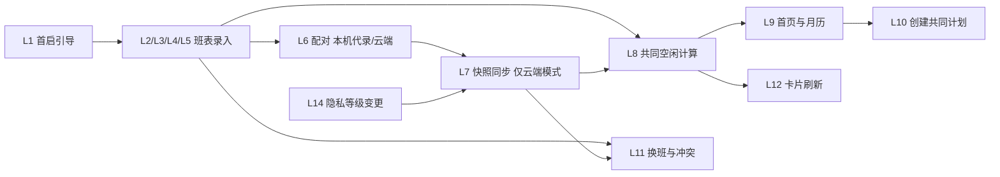
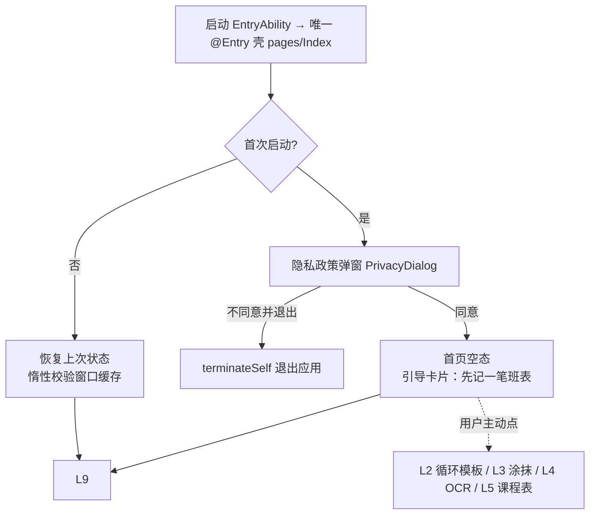
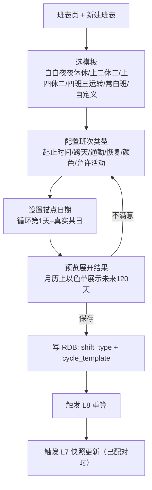
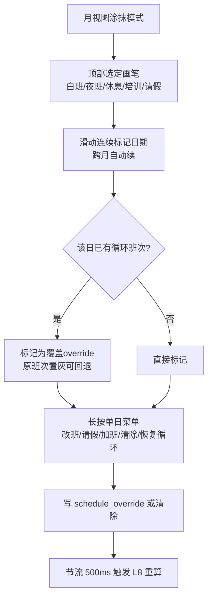
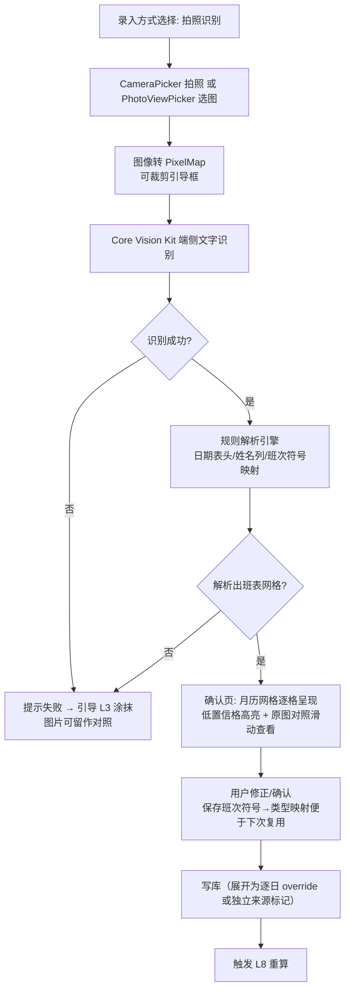
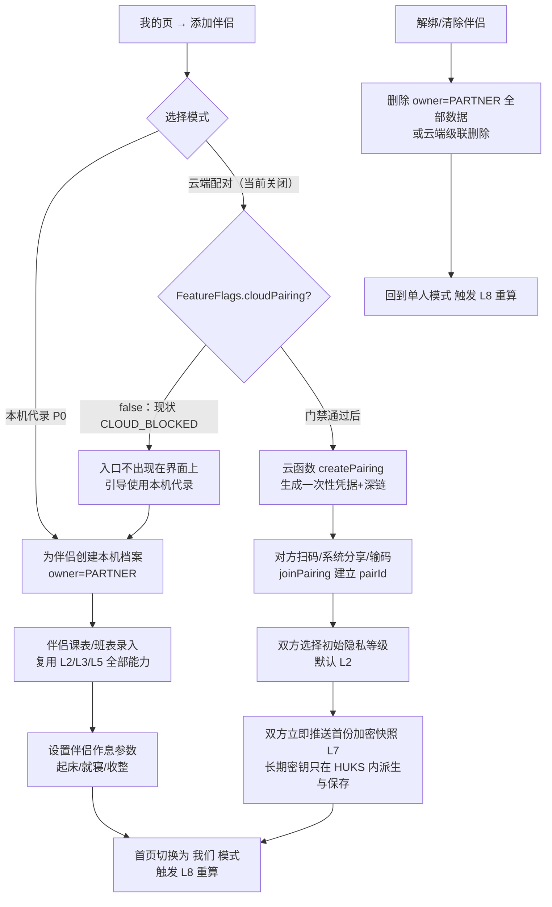
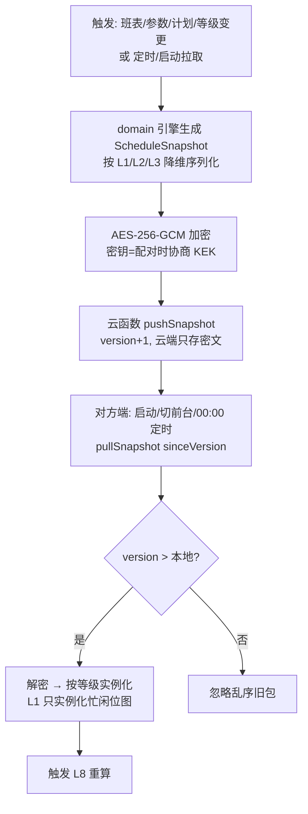
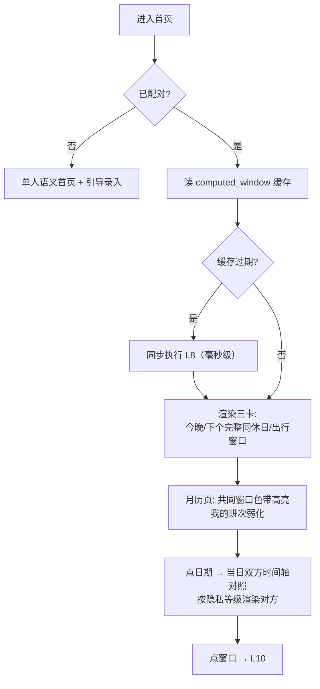
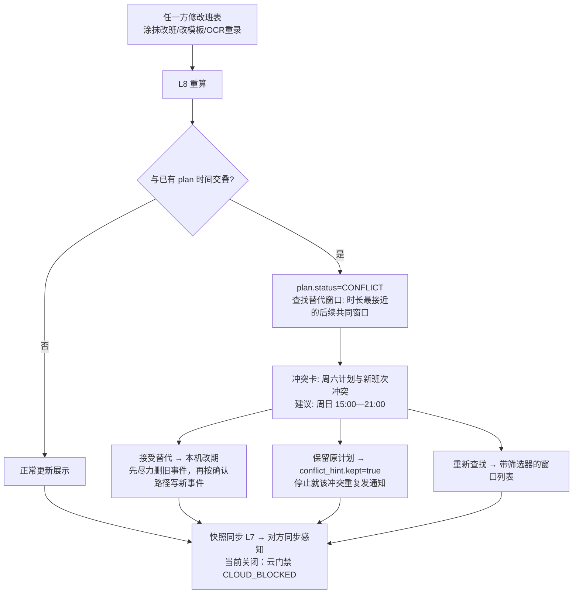
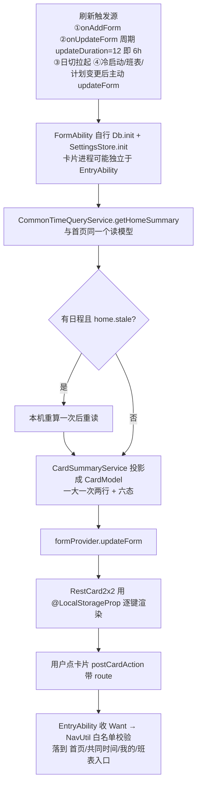

# 同休日 功能链路设计

> 与 [产品设计文档](./01-产品设计文档.md)（F1–F11 编号对应）、[技术架构设计](./02-技术架构设计.md)（模块名对应）配套阅读。
> 每条链路给出：主流程图 → 关键分支与异常 → 涉及模块。链路编号 L1–L14 可直接作为开发任务拆分与测试用例目录。
>
> **v1.1 修订**：L4（班表网格 OCR）降为 P1；L6 重构为"本机代录（P0 主路径）+ 云端配对（增强路径）"；L13（实况窗）移出首版；L8 补充本机代录装配路径；新增 L11 冲突检测的具体判定口径。
>
> **2026-09-23 定点更正（阶段 6 Task 6.3）**，与代码逐条对齐后就地标注：
> ① 全链路**没有华为账号登录**这一步（不接 Account Kit）；② L6/L7 的云端分支当前被关闭（Task 0.4 `CLOUD_BLOCKED`，`FeatureFlags.cloudPairing=false`），画的是门禁通过后的目标态；
> ③ 日历写入只作用于**本机**，"级联更新/删除双方日历"是错的；④ L12 卡片只有 2×2 一种形制，内容不是倒计时挂件；
> ⑤ L13 实况窗**移出产品范围**（无 LiveViewKit 依赖），下面只留作废说明；⑥ 导航是三个底部入口 + Navigation 栈，L9 里的 Tab 编号按此理解。
> 冲突时以代码 + [改造方案](./superpowers/plans/2026-09-21-overall-project-redesign.md) + [真机验收清单](./testing-checklist.md) 为准。

## 链路总览



---

## L1 首次启动与引导



**分支/异常**：拒绝隐私政策 → `terminateSelf` 退出（未同意前全屏拦截，不可进入任何页面）；`SettingsStore` 初始化或读标记失败 → **按"未同意"处理并重弹**（宁可多问一次，不可默认放行）。
**模块**：`entryability/EntryAbility`、`pages/Index.ets`、`component/PrivacyDialog`、`data/settings/SettingsStore`（首启标记）。
> 更正：旧稿这里的"欢迎引导页 3 步说明产品价值"与"登录华为账号（仅配对前强制）"都**没有实现、也不在范围内**——首启只有隐私弹窗，之后直接进首页空态；全链路不存在账号登录节点（不接 Account Kit）。初始录入路径由首页/班表入口自己承担，不做一次性向导。

## L2 循环班表录入（手动循环）



**分支/异常**：锚点选错可在预览中平移循环；同名班次复用已有类型。
**模块**：feature/schedule、domain/expand、data。

## L3 日历涂抹录入



**分支/异常**：60 天以上滑动用懒加载网格；涂抹与模板共存时 override 优先，UI 上原循环班次半透明显示。
**模块**：feature/schedule（月历组件复用 cotime 的网格）、data。

## L4 拍照/截图 OCR 录入（P1，v1.1 降级）

> 首版 OCR 仅覆盖**课程表行文本**（走 L5 的 C2 分支，已实现）。班表网格解析（姓名列/班次符号映射/逐格确认页）为 P1 内容，主流程保留如下，实施时以涂抹（L3）兜底。



**分支/异常**：识别人的姓名与当前用户不匹配时提示"请框选自己的行/列"；同名多列（团队排班）支持选择姓名。
**模块**：feature/schedule/ocr、domain（解析规则）、commons（图像工具）。

## L5 大学生课程表导入

```mermaid
flowchart TD
    A[录入方式: 课程表] --> B{导入途径}
    B -- 文本粘贴 --> C1[教务系统课表文本\n正则/模板解析]
    B -- 截图/拍照 --> C2[走 L4 OCR + 课程网格解析]
    B -- 手动 --> C3[逐门添加课程]
    C1 & C2 & C3 --> D[课程列表确认\n名称/星期/节次/周次/单双周/地点]
    D --> E[设置学期锚点\n第一周周一日期]
    E --> F[配置作息模板\n节次→时间映射]
    F --> G[预览: 学期周视图\n验证单双周与周次范围]
    G -- 保存 --> H[写 course + term_config]
    H --> I[触发 L8 重算]
    I --> J[筛选器出现"共同自习"入口]
```

**分支/异常**：节次模板缺失时按"8:00 起，每节 45+10 分钟"默认生成并可改；周次超出范围不产生忙碌块；考试周整段涂抹"复习"走 L3。
**模块**：feature/schedule/course、domain/expand（课程展开器）。

## L6 配对（v1.1：本机代录 P0 主路径 + 云端配对增强路径）



**分支/异常**：凭据过期/已用 → 提示重新生成；一方已有伴侣关系 → 需先解绑；AGC 未配置/无网 → 云端入口灰置并引导本机代录；解绑后本地保留只读历史（可清空）。
**模块**：`feature/integration/PairingShareGateway`（扫码 + 系统分享 + 深链校验，受 `scanPairing`/`cloudPairing` 双开关）、`domain/pair`（短码/深链解析）、`data`（owner 维度）、`cloud`（仅云端模式）。
> 更正：① 这里以前写"华为账号已登录且 AGC 就绪?"——**没有账号登录这个前置**，判据是 `FeatureFlags.cloudPairing`；② "生成短码 24h 有效"改为"一次性凭据"，因为**邀请码不得直接派生长期密钥**（改造方案 §0.3），协议细节以 [pairing-protocol-v1.md](./cloud/pairing-protocol-v1.md) 为准；③ 端侧代码已落地但入口关闭，所以这条链路当前不可在真机上走通，不是"待开发"。

## L7 快照同步（隐私分级，仅云端配对模式）



**分支/异常**：解密失败 → 卡片进 `PAIR_PENDING` + 本机一次"需要重新配对"通知；离线 → 入待同步队列，恢复网络补发（重试复用同一 `requestId` 保幂等）。
**模块**：`domain/snapshot`（位图降维与还原）、`cloud/api`（`CloudApi` + `SnapshotCrypto`）、`data`（`sync_meta` 版本号）。
> 更正：① 触发条件删掉"收到 P1 推送"——**没有 Push Kit**，只有拉取；② 整条链路受 `CLOUD_BLOCKED` 门禁，`cloudPairing=false` 时不会被走到，本图是门禁通过后的目标态；③ "指数退避 3 次"改为按协议文档的幂等重试口径（[pairing-protocol-v1.md](./cloud/pairing-protocol-v1.md) §3）。

## L8 共同空闲计算（引擎数据流）

```mermaid
flowchart TD
    A[输入① 我的班表\n模板+override+课程+计划] --> C[expand]
    B[输入② 对方快照\n忙区间(按等级)] --> D[buffer→区间归一]
    C --> D
    D --> E[merge: 双人忙区间并集→取补]
    E --> F[classify 打标\nMEAL/HALF_DAY/FULL_DAY/WEEKEND/TRIP/OVERNIGHT/STUDY]
    F --> G[写 computed_window 缓存]
    G --> H[通知 VM/卡片/冲突检查]
```

**触发时机**：L2/L3/L4/L5 保存、参数变更（通勤/恢复/作息）、L7 快照更新、L10/L11 计划变更、每日 00:00。

> v1.1：本机代录模式下，引擎装配为"我的班表（owner=ME，我的参数）+ 伴侣班表（owner=PARTNER，伴侣参数）"，两条 expand→buffer 管线分别构建忙区间后进入 merge。云端模式下伴侣忙区间来自快照解码，不二次加缓冲。

**异常**：参数非法（恢复>12h） UI 层限制；计算本身纯函数无副作用，异常即缺陷由单测兜底。
**模块**：domain 全部、data（缓存）、feature/cotime。

## L9 首页与共同月历展示



**分支/异常**：视界内（默认 120 天）没有任何窗口 → 空态说清"算过了、确实没有"并给可动作（放宽作息/收整参数、看更远的日子），不能和"还没录班表"共用一句文案；对方 L1 时对照轴只显示忙/闲色块，无文字。
**模块**：`feature/usecase/CommonTimeQueryService`（首页/共同时间读模型，答案优先）、`feature/performance/RecomputeExecutor`（引擎段跑在哪个线程的唯一决定点）、`entry/view/HomeView`、`entry/view/CoTimeView`。
> 更正：① 三卡口径是"今晚 / 下个完整同休日 / 出行窗口"，读的是同一个 `HomeSummary`，**不是各自再算一遍**；② "同步执行 L8"不准确——重算是否内联跑由 `RecomputeExecutor` 按采样预算决定（120 天稠密配对 P95 14.30ms 贴着 16ms 预算，≥150 天才迁移 worker）；③ 顶部 Tab 只有三个（首页/共同时间/我的），班表在「我的」侧的导航栈里，旧四 Tab 形态已退场。

## L10 创建共同计划 → 日历 → 提醒

```mermaid
flowchart TD
    A[窗口详情页\n时间轴可视化 + 时长] --> B[选计划类型\n吃饭/电影/接送孩子/回家/办事/旅行/自习/自定义]
    B --> C[命名 + 调整起止\n硬限制在窗口内]
    C --> W{Sheet 上的\n「写入系统日历」开关}
    W -- 关（可回改） --> W0[只落本机 plan 表\ncalendar_state=LOCAL_ONLY]
    W -- 开（默认） --> D{首次写日历?}
    D -- 是 --> D1[弹 READ/WRITE_CALENDAR 授权]
    D1 -- 拒绝 --> D2[仅本地创建+提醒\n下次动作会再请求]
    D1 -- 同意 & 拒绝后重试成功 --> E
    D -- 否 --> E[取/建"同休日"专属 LOCAL 日历账户\ngetCalendar 失败则 createCalendar]
    E --> F[cal.addEvent 受管写入\n不弹系统日程编辑页]
    F --> G[写 plan 表 + calendar_state=MANAGED_WRITTEN/my_event_id]
    G --> J[首页/卡片显示下一个共同计划]
    J --> K[取消计划 / 采用替代时间]
    K --> L[确认弹窗 → cal.deleteEvent + 撤提醒\nplan.status=CANCELLED → L8 重算]
    L -- 删不动 --> M[保留 my_event_id/reminder_id\ncalendar_state=CLEANUP_PENDING\n卡片「重新清理」+ 回前台补扫]
    G -.可选出口.--> X[「导出到系统日历」mgr.editEvent\n→ EXTERNAL_UNMANAGED，本应用不再自动同步]
```

**分支/异常**：能力结果（`CalendarOutcome`：`DENIED`/`UNAVAILABLE`/`FAILED`/`CANCELED`）经 `calendarStateOf` 落成 `CalendarState`（`LOCAL_ONLY`/`UNSUPPORTED`/`FAILED`），**计划照样创建成功**，重试入口在计划卡片（`canRetryCalendarSync` 给「写入日历」、`canExportToCalendar` 给「导出到系统日历」，`calendarFlow` 关档时两个都不给）；删除失败**不是记一条日志了事**——句柄留着、状态转 `CLEANUP_PENDING`，卡片给「重新清理」，`EntryAbility.onForeground` 走 `sweepPendingProjections` 自动补一次；读库时旧值经 `normalizeCalendarState` 归一（`'WRITTEN'` → `EXTERNAL_UNMANAGED`，认不出的 → `NOT_REQUESTED`）；窗口被 L11 冲突作废 → 计划进入 CONFLICT 态。
**模块**：`feature/usecase/PlanUseCase`（编排 + `calendarFlow` 回退点）、`feature/usecase/PlanProjectionCleanupService`（只清系统侧、不写库）、`feature/integration/PlanCapabilities`（日历/提醒端口的唯一持有者）、`feature/integration/CalendarGateway`、`ReminderGateway`、`feature/model/PlanFlow`（状态机与清理报告口径）。
> 更正：① **"对方也写日历"不成立**——日历写入只作用于本机，全仓没有对端写入代码，`peer_event_hint` 列也不存在；对方要不要把同一段时间记进自己的日历，是对方设备上自己创建计划、自己确认的独立动作。② 阶段 6R.1 把方向换了：**默认是专属日历的 `addEvent` 受管写入**，`editEvent` 反过来降级成「导出到系统日历」这一个出口——因为 API 26 SDK 写明 `editEvent` 之后要 `READ/WRITE_WHOLE_CALENDAR`（system_basic，普通应用拿不到）才改得动，拿它当默认就等于给取消/改期埋孤儿。"逐条创建、不批量"仍成立：写不写由用户在计划 Sheet 的开关上当面决定。③ 旧稿的"本地通知授权引导"不在这里：通知授权只在「我的」里用户亲手打开开关时才弹（`MeView` → `NotificationGateway.requestEnabled`），创建计划后不引导。

## L11 换班修改 → 重算 → 冲突处理



**分支/异常**：无替代窗口 → **不给假建议**（`altStart = 0` 时弹窗只给"取消计划"，不出现"改到替代时间"）；双方同时修改 → 以快照 version 高者为准，低者本地下一次拉取时对齐（当前档位不发生）。

**冲突判定口径（v1.1 明确）**：重算时对每个状态 OK 的计划 P：构建"排除 P 自身占用"的双方忙区间并集，若 P 的区间与之交叠 >0 分钟 → P 置 CONFLICT；替代窗口 = 满足"时长 ≥ P 时长"的最近后续共同窗口（取时长最接近者）。

**模块**：`domain/conflict/PlanConflict`（交叠判定 + 替代窗口）、`feature/usecase/ScheduleUseCase.detectAndWriteConflicts`（回写 `plan.conflict_hint`）、`entry/view/PlansView`（三个动作）、`feature/integration/NotificationGateway`（该不该吵用户一次）。

## L12 服务卡片刷新



**分支/异常**：任何一步抛错 → `degraded()`（`STALE` 态"打开 App 会自动重新计算"），绝不抛给卡片框架；`onAddForm` 先回占位"正在计算…"再异步回填；未录日程 → `NO_SCHEDULE` 而不是"没有共同空闲"（避免把没录入读成没时间）；已标配对但对方数据没同步到本机 → `PAIR_PENDING`；`FeatureFlags.newCard=false` → 两个入口只下发"桌面卡片已停用"，不读库不重算。
**模块**：`entryformability/FormAbility`、`entry/widget/RestCard2x2`、`feature/usecase/CardSummaryService`、`feature/usecase/CommonTimeQueryService`。
> 更正：① **只有 2×2 一种形制**，旧稿的"2x4：倒计时+时间线+下个计划"不存在；② 卡面**不是倒计时挂件**——"距下次共同休息还有 N 天"这一版文案早被换成答案优先的两行（今晚 / 下个完整同休日），结论与首页同源；③ 点击**不带窗口 id**，落点是路由白名单里的 Tab/栈目的地，不是"那条窗口的详情页"（见 [testing-checklist.md](./testing-checklist.md) §11.16）；④ 卡片只从桌面添加，App 内没有添加入口与预览页（无 `formBindingControl`）。

## L13 实况窗（已作废，不在产品范围）

> 本节整条链路**作废**：全仓没有 `@kit.LiveViewKit` 依赖，也没有权益申请动作。
> 原因保持为真：权益审批不可控、降级方案（普通通知 + ReminderAgent）体验差距有限——但结论不再是"二期再做"，而是**移出范围**（PRD F9、README「明确不做」）。
> 当天计划的提醒实际走 L10/L11 的通知与提醒口径。编号 L13 保留占位，不再复用给别的功能，避免测试用例目录串号。

## L14 隐私等级变更

```mermaid
flowchart TD
    A[设置 → 共享范围] --> B[L1 忙闲 / L2 班次类型默认 / L3 完整时间]
    B --> C[明示"改后对方可见内容"对照说明]
    C --> D[保存 Preferences → 立即触发 L7 新快照]
    D --> E[对方端按新等级重渲染\nL3→L1 后精确时间立即不可见]
```

**分支/异常**：升/降级均生成新 version 快照，无需双方确认（主动权在数据所有者）；解绑时快照删除。
**模块**：`feature/usecase/ProfileSettingsService`（等级读写与生效）、`data/settings/SettingsStore`（Preferences）、`domain/snapshot`（降维）、`cloud`（推送）。
> 更正：隐私等级只在**云端配对模式**下有意义（它约束"上传多少"）。当前 `cloudPairing=false`，所以这条链路的末端 L7 不会被触发；**本机代录模式下伴侣数据本来就全在本机**，不存在"对方看到我的精确时间"这一风险面，界面上的等级说明也按这个事实写。

---

## 测试用例映射

> 本表是"该测什么"的目录，**不是通过记录**。逐条的执行与证据口径（离线单测 / 离线预算 / 真机插桩 / 手工走查）以 [testing-checklist.md](./testing-checklist.md) 为准；这里只标出哪些用例当前根本不可执行。

| 链路 | 必测用例（节选） | 当前可执行性 |
|------|------------------|--------------|
| L2/L8 | PRD F4 示例精确复现；跨天夜班；31 天循环锚点；override 覆盖回退 | 离线单测（`domain/src/test`，`node tools/test/run.mjs`） |
| L4 | 20 样本集成功率 ≥85%；姓名不匹配提示 | **待设备 + 待样本**（OCR 要真机相机） |
| L5 | 单双周×周次范围；节次模板变更全表联动 | 离线单测 + 手工走查 |
| L6 | 本机代录建档/编辑/清空；（云端）两真机配对、过期凭据、重复配对拦截 | 本机代录可走查；**云端三项不可执行**（`cloudPairing=false`，无云资源） |
| L7 | 三等级序列化往返；版本乱序丢弃；解密失败重配 | 往返与乱序=离线单测；**云侧端到端不可执行** |
| L10 | 授权拒绝降级；取消时删除本机日历事件 | 真机插桩（`hilog` 过滤 `CalendarGateway`）；**"级联删除双方日历"作废** |
| L11 | 冲突检出；替代窗口排序正确性；`kept` 后不重复通知 | 离线单测（`domain`）+ 真机通知走查 |
| L12 | 杀进程后卡片展示；日切刷新；六态各自可达 | **待设备**（卡片无法离线渲染） |
| L13 | — | 已作废，无用例 |
| L14 | 等级变更后本机等保/恢复态渲染 | 离线单测（快照降维）+ 手工走查 |
